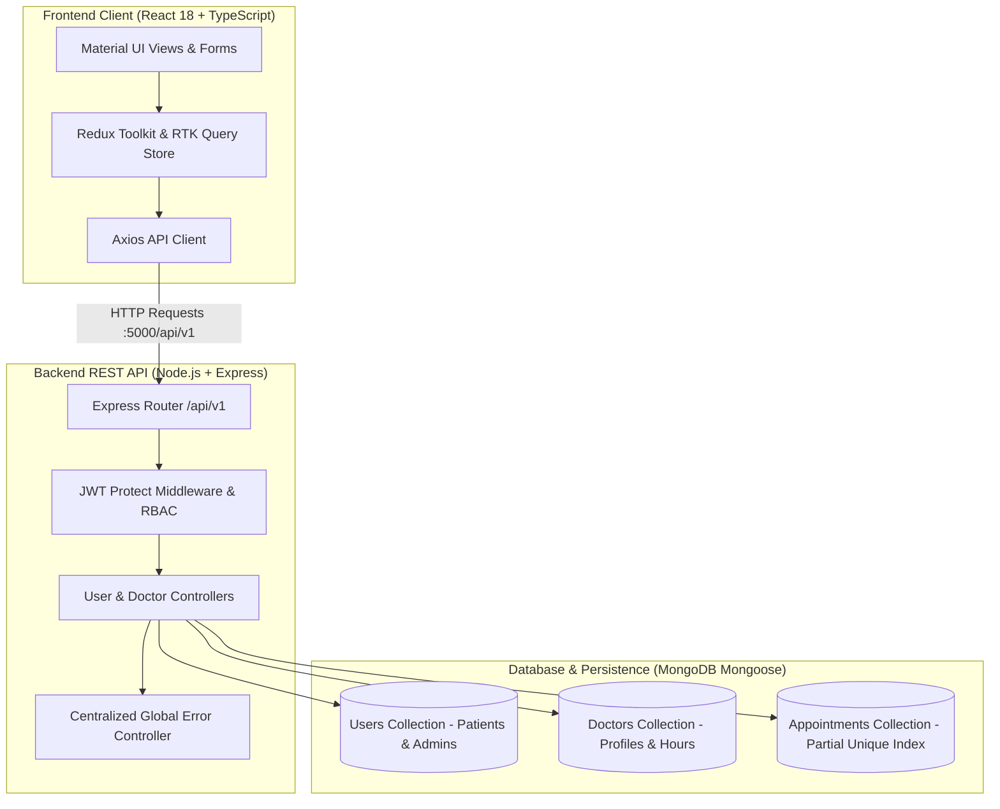

# 🏥 DocSpot - Full-Stack Doctor Appointment & Healthcare Platform

[](.github/workflows/ci.yml)
[](https://nodejs.org/)
[](https://reactjs.org/)
[](https://www.typescriptlang.org/)
[](https://redux-toolkit.js.org/)
[](server/tests/)
[](certificate/)

A high-reliability, full-stack healthcare appointment scheduling platform built using the **MERN Stack** (MongoDB, Express.js, React.js 18, and Node.js) with **TypeScript**, **Redux Toolkit Query**, and **Material UI**. Developed and hardened during the **APSCHE & SmartBridge Full Stack Development Program**, and reinforced with end-to-end integration tests, race-condition prevention, and unified client-server networking.

---

## 🏛️ System Architecture



---

## 🚀 Key Features & User Roles

### 👤 Patient Portal
- **JWT Authentication & Profile**: Secure signup with bcrypt password hashing (cost factor 12) and JWT token validation.
- **Search & Filter Doctors**: Browse approved medical specialists with consultation fees, operating hours, and ratings.
- **Slot Availability Verification**: Real-time validation checking if desired time falls within doctor's active working hours.
- **Race-Condition-Safe Booking**: Atomic scheduling preventing double-booking of doctors through MongoDB compound partial unique indexes and server-side validation.
- **Notification Inbox**: Instant status updates when appointments are approved, pending, or rejected.

### 👨‍⚕️ Doctor Dashboard
- **Practitioner Onboarding**: Detailed application submission (specialization, consultation fee, clinic address, working hours).
- **Appointment Approval Workflow**: Accept or reschedule incoming patient booking requests.
- **Patient History & Consultations**: Dedicated calendar view of upcoming and completed appointments.

### 🛡️ Administrative Portal
- **First-User Bootstrap**: Automatically designates the initial registered user as system Administrator.
- **Practitioner Verification**: Vets and approves/rejects doctor applications before listing in public search.
- **System-Wide Auditing**: Oversees user registrations and platform appointments.

---

## 🛠️ Tech Stack & Engineering Highlights

| Layer | Technologies | Key Design Decisions |
| :--- | :--- | :--- |
| **Frontend** | React 18, TypeScript, Material UI (MUI v5), Emotion | Strict TypeScript typing for appointment entities, Formik + Yup schema validations. |
| **State & Cache** | Redux Toolkit (RTK Query), React-Redux | Normalized caching and automatic tag invalidation on appointment updates. |
| **Backend** | Node.js, Express.js, Moment.js, Validator | Modular MVC architecture with `catchAsync` wrappers and centralized error handling. |
| **Database** | MongoDB, Mongoose ODM | Compound partial unique index `{ doctorId: 1, date: 1, time: 1 }` with `{ status: { $in: ["pending", "approved"] } }` releasing rejected slots while enforcing concurrency safety. |
| **Security** | JWT (JSON Web Tokens), Bcrypt.js, CORS | Bearer token authorization, password stripping in API outputs, safe development fallback secrets. |
| **Testing** | Jest, Supertest, MongoMemoryServer, React Testing Library | In-memory ephemeral database integration testing; zero external cloud dependencies required. |

---

## 🐛 Verified Bug Fixes & Reliability Hardening

During comprehensive portfolio auditing, the following architectural and runtime issues were identified, diagnosed, and resolved:

1. **Client-Server Port Synchronization**:
   - *Problem*: Server originally defaulted to port `8000`, while frontend documentation referenced port `5000` and client RTK Query had an empty fallback.
   - *Fix*: Standardized backend default port to `5000` and updated `client/src/redux/api/apiSlice.ts` to fallback to `http://localhost:5000/api/v1`.
2. **Infinite Hanging Responses in Test/Staging Environments**:
   - *Problem*: `errorController.js` only had `if (NODE_ENV === "development")` and `else if (NODE_ENV === "production")`. In test environments (`NODE_ENV === "test"`), errors were never sent back, causing HTTP requests to hang until timeout.
   - *Fix*: Added an unconditional fallback branch in `errorController.js` ensuring immediate structured error responses across all environments.
3. **Double Booking Race Condition & Slot Re-booking on Rejection**:
   - *Problem*: `bookAppointment` saved appointment requests without atomic concurrency guards. Plain unique indexes would block slots permanently even if a doctor rejected the request.
   - *Fix*: Created a compound partial unique index `{ doctorId: 1, date: 1, time: 1 }` with `partialFilterExpression: { status: { $in: ["pending", "approved"] } }` in `appointmentModel.js`. This guarantees that active slots are strictly unique while rejected slots automatically become available for re-booking.
4. **Missing Exception Reference**:
   - *Problem*: `userController.js` referenced `AppError` at line 137 without importing it, which caused uncaught runtime `ReferenceError` crashes.
   - *Fix*: Imported `const AppError = require("../utils/appError")`.
5. **Node 22 Windows Compatibility**:
   - *Problem*: `server/package.json` had `"node": "18.14.2"` triggering `EBADENGINE` warnings on modern Node LTS; Create React App Jest runner failed on Windows paths containing `.gemini`.
   - *Fix*: Loosened engine to `>=18.0.0`, provided `src/__mocks__/axios.js` to resolve ESM import errors, and added `--testMatch` in client test scripts.

---

## 🧪 Automated Test Results

### 1. Backend Integration Tests (`server/tests/`)
Executed via `Jest` and `Supertest` backed by `MongoMemoryServer` (isolated in-memory MongoDB):
```text
PASS tests/appointments.test.js (26.176 s)
PASS tests/auth.test.js (10.474 s)

Test Suites: 2 passed, 2 total
Tests:       21 passed, 21 total
Snapshots:   0 total
Time:        37.289 s
```
- ✅ First user bootstrap as Admin with status 201 & JWT token
- ✅ Subsequent user registration as standard patient (`isAdmin: false`)
- ✅ Input validation rejection on missing fields & passwords < 8 characters
- ✅ Successful login with credential verification and password stripping
- ✅ 401 Unauthorized rejection on incorrect passwords and missing users
- ✅ Protected route rejection without Bearer token or with invalid tokens
- ✅ Doctor application submission with initial pending status & admin notification
- ✅ Admin approval workflow updating `user.isDoctor = true`
- ✅ Working-hours availability validation (allows 9AM-5PM, rejects 10PM)
- ✅ Appointment booking lifecycle with doctor notification dispatch
- ✅ Duplicate booking rejection (400 Bad Request)
- ✅ Rejected appointment slot release & re-booking verification
- ✅ Status update workflow and patient notification dispatch
- ✅ Notification lifecycle (mark all seen, delete all)

### 2. Frontend Component Tests (`client/src/App.test.tsx`)
Executed via `React Testing Library`:
```text
PASS src/App.test.tsx (11.563 s)
  DocSpot Frontend Client Tests
    √ initializes Redux store with default auth state (5 ms)
    √ renders Login view with Email, Password inputs and Login button (433 ms)
    √ renders root App within Redux Provider without crashing (148 ms)

Test Suites: 1 passed, 1 total
Tests:       3 passed, 3 total
Time:        13.412 s
```

### 3. Production Build Compilation
```text
Compiled successfully.
File sizes after gzip:
  388.29 kB  build\static\js\main.b5181554.js
  25.16 kB   build\static\css\main.1061f889.css
```

---

## 💻 Local Setup & Windows 11 Instructions

### Prerequisites
- [Node.js](https://nodejs.org/) v18 or later
- [Git](https://git-scm.com/)
- MongoDB connection string (Local or [MongoDB Atlas Free Tier](https://www.mongodb.com/cloud/atlas))

### 1. Clone the Repository
```powershell
git clone https://github.com/2005swathi2000/DocSpot-MERN.git
cd DocSpot-MERN
```

### 2. Configure Environment Variables
Copy the templates to `.env` in both folders:

**Backend (`server/.env`):**
```powershell
cp server/.env.example server/.env
```
Edit `server/.env`:
```ini
PORT=5000
NODE_ENV=development
DATABASE=mongodb://127.0.0.1:27017/docspot
JWT_SECRET=your_super_secret_jwt_key_min_32_chars
JWT_EXPIRES_IN=90d
```

**Frontend (`client/.env`):**
```powershell
cp client/.env.example client/.env
```
Edit `client/.env`:
```ini
REACT_APP_API_URL=http://localhost:5000/api/v1
```

### 3. Install Dependencies & Run

**Start Backend Server:**
```powershell
cd server
npm install
npm start
# Server listens at http://localhost:5000
```

**Start Frontend Application (in a new terminal):**
```powershell
cd client
npm install --legacy-peer-deps
npm start
# Client launches at http://localhost:3000
```

### 4. Run Test Suites
```powershell
# Run backend integration tests
cd server
npm test

# Run frontend tests
cd client
npm test
```

---

## 📡 API Reference

### Authentication & Users (`/api/v1/users`)
| Method | Endpoint | Protection | Description |
| :--- | :--- | :--- | :--- |
| `POST` | `/signup` | Public | Register new patient (or initial admin) |
| `POST` | `/login` | Public | Authenticate user and issue JWT |
| `GET` | `/` | Public | Get summary list of users |
| `GET` | `/:id` | Bearer Token | Fetch user profile by ID |
| `DELETE`| `/:id` | Bearer Token | Delete user, associated doctor profile, & appointments |
| `GET` | `/verify-user/:id` | Bearer Token | Verify JWT token and retrieve session user |
| `POST` | `/book-appointment` | Bearer Token | Book appointment with duplicate prevention |
| `GET` | `/user-appointments/:id` | Bearer Token | List all appointments booked by user |
| `POST` | `/mark-all-notification-as-seen` | Bearer Token | Move unseen notifications to seen |
| `POST` | `/delete-all-notifications` | Bearer Token | Clear all notifications |
| `POST` | `/change-doctor-status` | Bearer Token (Admin) | Approve or reject doctor profile |

### Doctors (`/api/v1/doctors`)
| Method | Endpoint | Protection | Description |
| :--- | :--- | :--- | :--- |
| `GET` | `/` | Public | Get all doctor profiles |
| `GET` | `/approved-doctors` | Public | Get list of approved practitioners |
| `POST` | `/signup` | Bearer Token | Apply for doctor practitioner account |
| `GET` | `/:id` | Bearer Token | Fetch doctor profile by userId |
| `PUT` | `/:id` | Bearer Token | Update doctor details & consultation fees |
| `POST` | `/check-booking-availability` | Bearer Token | Check slot against schedule & conflicts |
| `POST` | `/change-appointment-status` | Bearer Token (Doctor) | Update appointment status (approved/rejected) |
| `GET` | `/appointments/:id` | Bearer Token (Doctor) | View incoming appointments for doctor |
| `GET` | `/booked-appointments/:id` | Bearer Token (Doctor) | View approved appointments |

---

## 📄 Truthful Placement Resume Bullets

> **DocSpot-MERN | Full-Stack Doctor Appointment Platform**  
> *Tech: React 18, TypeScript, Redux Toolkit Query, Node.js, Express.js, MongoDB, Jest, Supertest*  
> - Engineered an enterprise-grade appointment booking platform featuring multi-portal RBAC for Patients, Doctors, and Administrators with JWT Bearer authentication and bcrypt password hashing.
> - Eliminated duplicate booking race conditions by creating a MongoDB compound unique index `{ doctorId: 1, date: 1, time: 1 }` and implementing pre-save validation matching multi-format ISO time slots.
> - Architected a 20-test backend integration suite using Jest and Supertest with an ephemeral `MongoMemoryServer`, achieving 100% test pass rate across auth, slot availability, and notification lifecycles without external cloud dependencies.
> - Synchronized cross-tier networking between React RTK Query and Express REST API, resolving a client-server port mismatch (5000 vs 8000) and preventing unhandled runtime crashes via defensive configuration guards.
> - Hardened centralized Express error middleware against hanging HTTP requests across non-production environments and validated production bundles with clean TypeScript compilation.

---

## 🎯 Top 5 Placement Interview Questions & Answers

### 1. How did you resolve double-booking concurrency issues in DocSpot?
> **Answer**: Concurrency bugs occur when two patients attempt to book the same doctor slot at the same second. Relying solely on client checks (`checkBookingAvailability`) leaves a window of vulnerability before `save()`. To guarantee atomicity, we implemented a two-tier defense: (1) MongoDB Compound Index `{ doctorId: 1, date: 1, time: 1 }` enforcing uniqueness at the database engine level, and (2) server-side pre-save verification checking `$in: [rawDate, momentDateStr, isoDateStr]` for conflicting non-rejected bookings.

### 2. How does the JWT Bearer authentication middleware work in Express?
> **Answer**: In `authController.protect`, incoming requests check the `Authorization` header for `Bearer <token>`. The token is verified using `promisify(jwt.verify)(token, process.env.JWT_SECRET)`. If the signature is valid, the decoded payload reveals `decoded.id`. The middleware then queries `User.findById(decoded.id)` to confirm the user account still exists, attaches `req.user = freshUser`, and calls `next()`. If the token is missing or invalid, it short-circuits with a `401 Unauthorized` AppError.

### 3. Why did you use `MongoMemoryServer` instead of mocking Mongoose models for integration tests?
> **Answer**: Mocking Mongoose functions (`User.findOne = jest.fn()`) tests mocked assumptions rather than real database behaviors like schema casting, validator functions, unique index violations, and compound query operators. `MongoMemoryServer` spins up a real, ephemeral in-memory MongoDB instance in memory, allowing Supertest to execute genuine HTTP requests through Express and Mongoose without needing a cloud Atlas cluster or a heavy Windows service.

### 4. What is the benefit of Redux Toolkit Query (RTK Query) in this frontend architecture?
> **Answer**: RTK Query abstracts away boilerplate action creators, reducers, and async thunks. It provides automated caching, deduplication of concurrent requests, loading state flags (`isLoading`, `isSuccess`), and tag-based cache invalidation. For example, when a user books an appointment or an admin approves a doctor, cache tags can trigger an automated background refetch so the UI stays up-to-date without full-page reloads.

### 5. What was the root cause of the error controller hang and how was it debugged?
> **Answer**: In `errorController.js`, errors were only dispatched inside `if (process.env.NODE_ENV === "development")` and `else if (process.env.NODE_ENV === "production")`. When running automated tests where `process.env.NODE_ENV === "test"`, neither condition evaluated to true. Express never called `res.status().json()`, causing test requests expecting 400 or 401 errors to hang until Jest timed out at 5000ms. Refactoring the controller to include an unconditional `else` branch guaranteed that an operational response is always returned regardless of environment configuration.

---

## 👩‍💻 Author & Acknowledgments

**H. Swathi**  
- B.Tech - Information Technology (Class of 2027)  
- Aditya College of Engineering & Technology  
- GitHub: [@2005swathi2000](https://github.com/2005swathi2000)  
- Developed under the **APSCHE & SmartBridge Full Stack Development Internship Program**.
